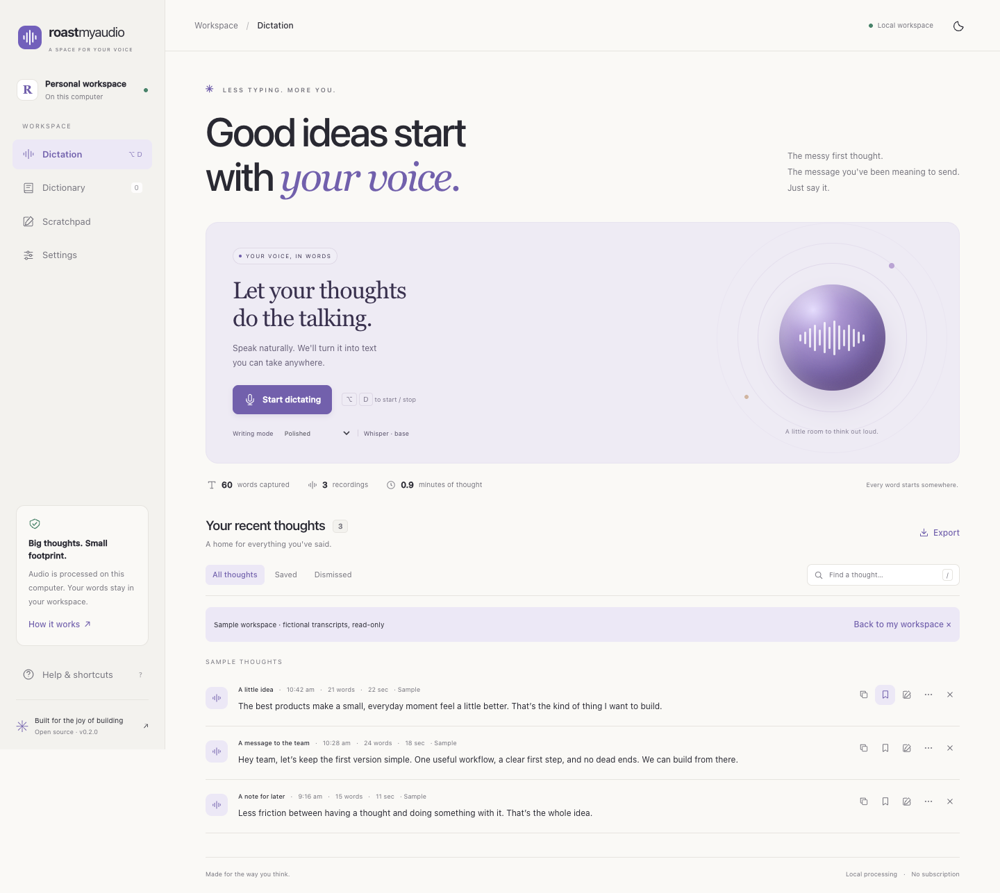

<p align="center"></p>
<h1 align="center">RoastMyAudio</h1>
<p align="center"><strong>A little less typing. A little more thinking.</strong><br>Turn your voice into words, in a workspace that runs on your computer.</p>
<p align="center"><a href="#get-started">Get started</a> · <a href="docs/INSTALLATION.md">Setup guide</a> · <a href="docs/PRIVACY.md">Privacy</a> · <a href="https://github.com/heyaaakash/roastmyaudio/issues">Report a bug</a></p>



*Actual web interface, captured with fictional sample transcripts. This is an unpublished preview. A local Mac app bundle is buildable; human microphone use and signed installation still need release validation.*

## Why I built it

I'm Aakash, a product manager who is very fond of building things. I like taking a small frustration, making something that helps, and getting the details right through use.

This one started with the gap between having a thought and typing it out. I wanted a place to speak, find the useful words, and move on. The name is a little playful; the goal is practical: make a tool I'd reach for myself.

RoastMyAudio is my workbench for that idea. It uses faster-whisper for speech recognition, with optional local AI cleanup. The experience takes inspiration from thoughtful voice tools like [Wispr Flow](https://wisprflow.ai/), with its own interface and implementation. It isn't affiliated with Wispr and doesn't claim feature or performance parity.

## What you can do

- **One place to speak.** Mac workspace buttons, menu actions, and shortcuts control one recording session, with the same microphone, history, and preferences. The menu app opens its workspace in a native window.
- **A clear first minute.** Guided setup explains permissions, prepares the speech model, and offers a practice dictation. Microphone access is enough for workspace recording; system shortcuts and paste need additional permissions.
- **Keep your work.** Drafts, appearance, vocabulary, settings, and saved recordings persist across restarts and workspace port changes. Failed native inference retains audio for retry; completed thoughts are searchable, playable, exportable, and recoverable after dismissal.
- **Words that work your way.** Add recognition hints, exact correction pairs, whole-phrase snippets, and app-specific writing styles. Nothing is learned automatically. Optional local AI enables style rewrites.
- **Stay in control.** Hold-to-talk or tap-to-toggle, a fallback shortcut, pause/resume, input selection, optional feedback and context, and an explicit launch-at-login control in the bundled app.
- **A considered workspace.** Light/dark appearance, responsive layouts, keyboard controls, dialog focus, audio-reactive animation, and reduced-motion support. Diagnostics omit human content; release checking opens GitHub manually.

Recognition and cleanup can make mistakes. Review your words before sharing them. There is no account, subscription, paid quota, meeting bot, automatic updater, or cross-device sync. The standalone browser remains available for development and local web use.

## Get started

For the unified Mac source preview, use **Python 3.12** and an interactive macOS desktop:

```sh
git clone https://github.com/heyaaakash/roastmyaudio.git
cd roastmyaudio
make setup-macos PYTHON=python3.12
make run            # menu app + native workspace + managed local server
```

Follow the first-run setup: allow Microphone, prepare the speech model, then try a practice sentence. Choose **Open Workspace…**, **Recent Thoughts…**, or **Preferences…** from the menu. Closing the window keeps the menu app running; quitting releases capture and stops its server. Fn is the default hold shortcut, with **Ctrl+Option+D** as a fallback; permission-dependent behavior still needs a human check.

The first model download needs internet and can take a while. Cached inference runs locally. Start with `base`; larger models need more disk space, memory, and processing time. Native/browser recordings stop after five minutes; browser uploads are limited to 25 MB.

To build the local Mac preview with its own Python runtime:

```sh
make setup-bundle
make build-macos    # dist/macos/RoastMyAudio.app + preview ZIP
```

The preview bundle is signed ad hoc and is **not notarized or ready for public distribution**. It was built and smoke-tested on this developer's Apple Silicon Mac. Developer ID signing, clean installation, real microphone/paste, and login registration remain launch gates. [Exact readiness evidence →](docs/VALIDATION.md)

For the standalone local browser workspace:

```sh
make setup
make web
```

Open **[localhost:5000](http://127.0.0.1:5000)**, start dictating, allow the browser microphone, speak, and finish. Copy the result or continue in Scratchpad. **Option/Alt+D** starts/stops, **/** focuses search, **?** opens help. Use `FLASK_PORT=5057 make web` if needed. This browser client uses its own capture lifecycle; the Mac app already includes its workspace server.

The package declares Python 3.10+; only 3.12 was checked. Other browsers, Windows/Linux, and real mobile devices remain unverified. [Capability matrix →](docs/CAPABILITY_MATRIX.md)

```sh
make setup-cleanup  # optional llama.cpp cleanup; may require compiler tooling
```

Without the cleanup dependency, speech recognition and rule-based formatting still work. [Detailed setup and troubleshooting →](docs/INSTALLATION.md)

## Your data, plainly

The Mac app saves recordings, transcripts, drafts, vocabulary, personalization, and preferences in `~/Library/Application Support/RoastMyAudio/`; models live in `~/Library/Caches/RoastMyAudio/`. Source web development uses project `data/` and `cache/` by default. The source Mac launcher imports known project data once into an empty desktop store without deleting the originals. A bundled app does not discover an unrelated source checkout.

Dismiss keeps recordings; Delete removes the entry and associated WAV. Native context reads clipboard text only when explicitly enabled and is off by default. Dictation into another app checks the foreground target before sending paste and restores clipboard formats when no newer clipboard change intervenes. Downloads contact package/model providers; the UI has no remote fonts or analytics. Keep the server on loopback. [Storage, retention, and deletion details →](docs/PRIVACY.md)

## Build with me

```sh
make test          # isolated behavior tests; inference/native endpoints mocked
make lint          # Python checks
make verify        # tests, dependency consistency, JS syntax, links, metadata
make screenshots   # optional Playwright captures with isolated fictional data
make smoke-macos   # real Cocoa/WebKit; fictional capture and mocked clipboard
make package       # inspected, re-extracted source archive
```

The canonical application code is in `src/`. Older prototypes in `macos_app/`, `web_mvp/`, and `whisper-flow/` are retained for reference and excluded from the source release archive. Use the root commands. Releases are prepared locally; this repo contains no GitHub Actions workflows.

Useful starting points: [development](docs/DEVELOPMENT.md), [architecture](docs/ARCHITECTURE.md), [contributing](CONTRIBUTING.md), [validation evidence](docs/VALIDATION.md), and [launch checklist](docs/LAUNCH_CHECKLIST.md).

Small fixes, careful feedback, and ideas grounded in an actual workflow are welcome. Please use fictional examples and redact private audio, transcripts, and clipboard content in issues.

[MIT license](LICENSE) · [Third-party attribution](docs/ATTRIBUTIONS.md) · [Security reporting](SECURITY.md) · [Changelog](CHANGELOG.md)
